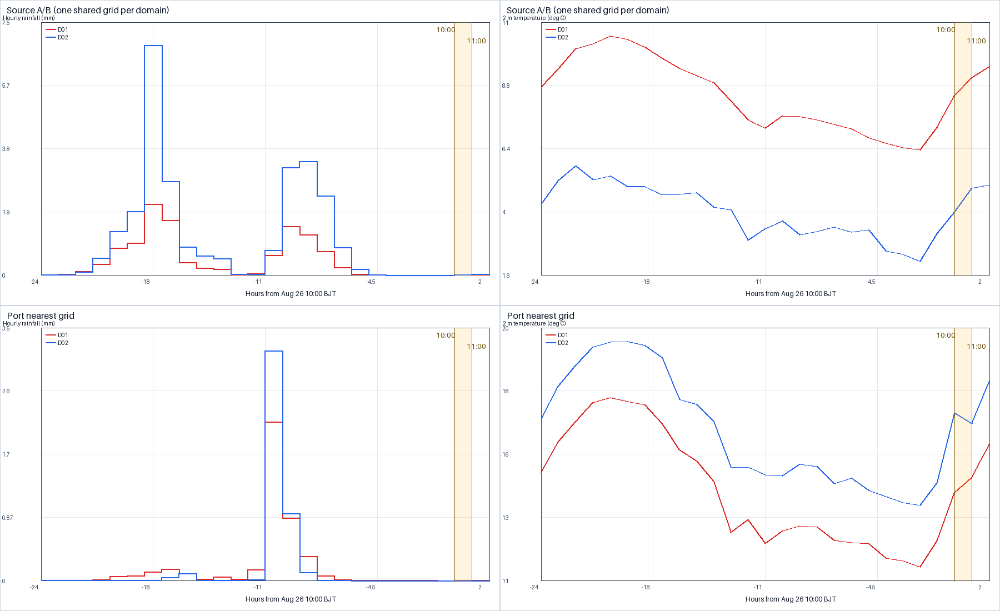
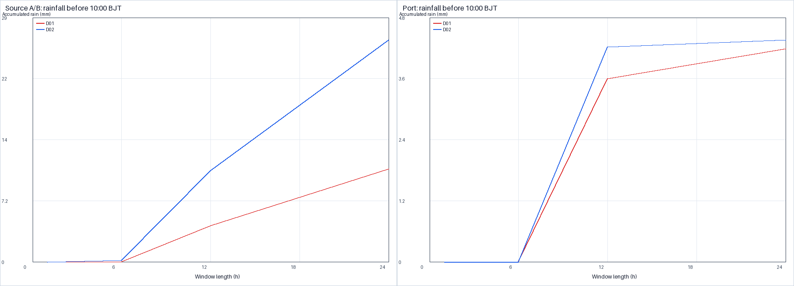
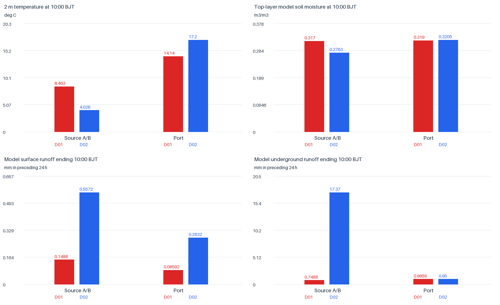
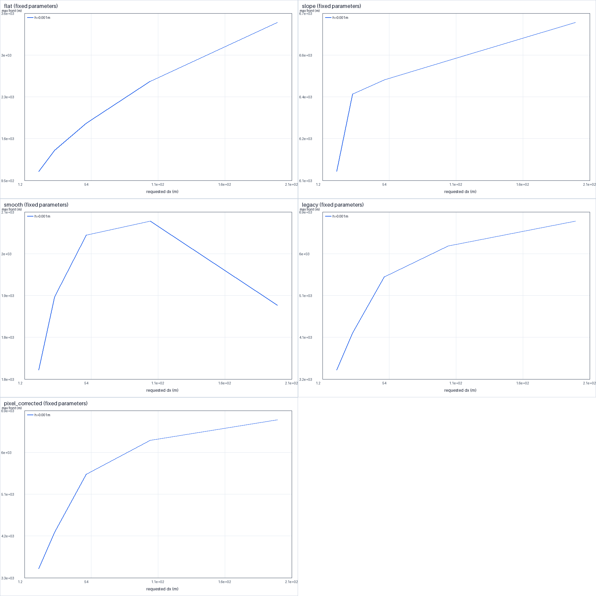
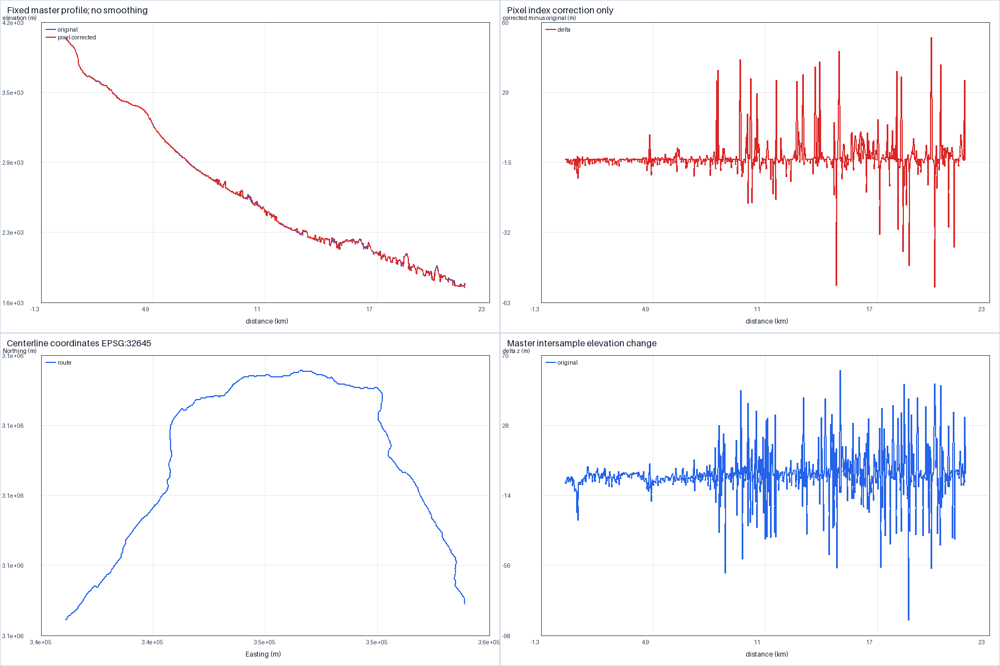
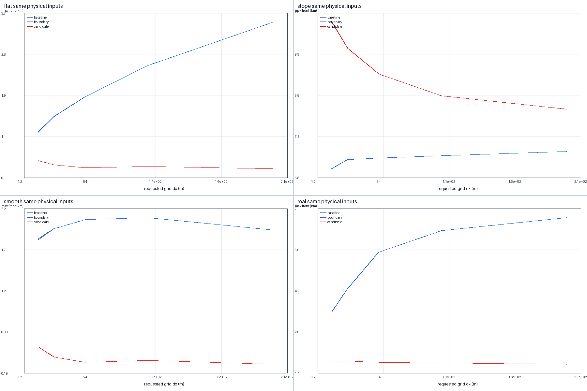
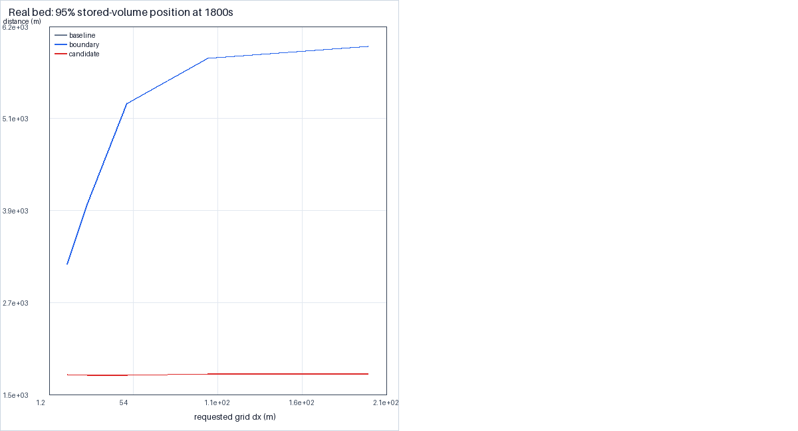
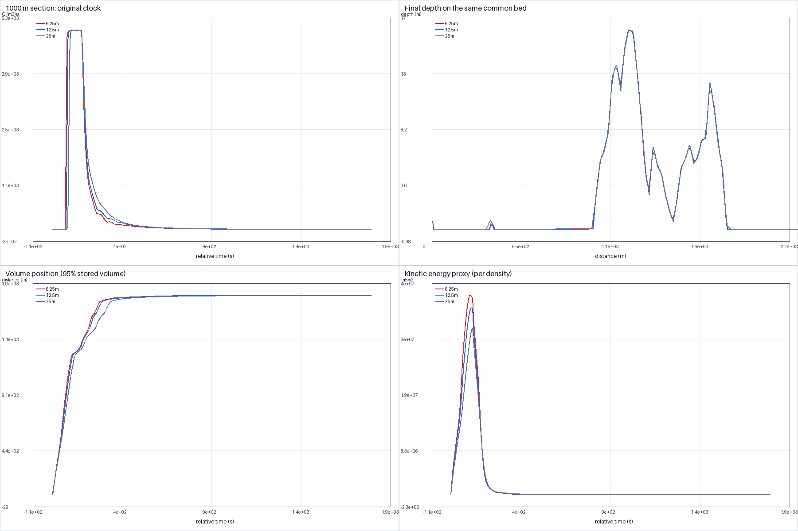
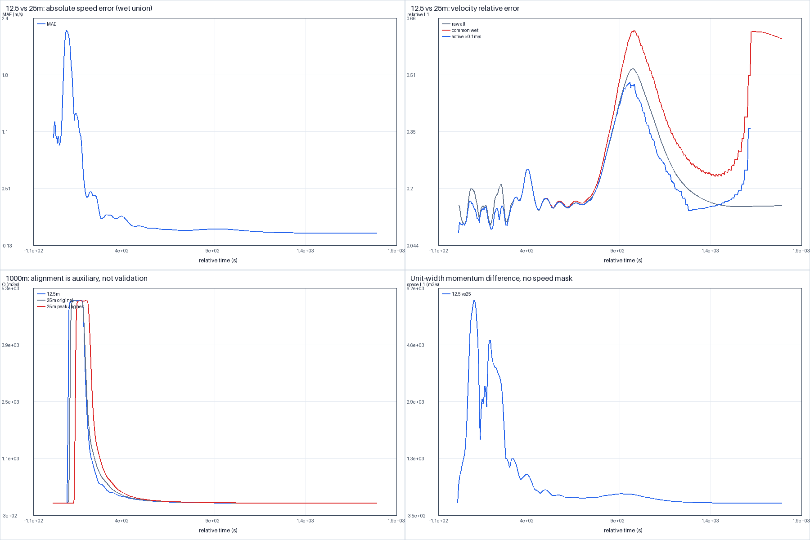

# 图表索引

全部新图及SHA见[研究图表清单](figure_manifest.csv)。

### F1 WRF嵌套域模式水热背景；非实测，小时区间，不用于因果识别

算法：D02 integration；原件：`output/wrf_d02_integration/q1_weather_comparison.png`。

### F2 WRF嵌套域模式水热背景；非实测，小时区间，不用于因果识别

算法：D02 integration；原件：`output/wrf_d02_integration/q1_antecedent_windows.png`。

### F3 WRF嵌套域模式水热背景；非实测，小时区间，不用于因果识别

算法：D02 integration；原件：`output/wrf_d02_integration/q2_hydrothermal_comparison.png`。

### F4 一维数值实验与网格敏感性；非真实灾害验证；候选与基线分开

算法：candidate/baseline identified per table; see code_versions.csv；原件：`output/question4/convergence_diagnostics/convergence_diagnostics.png`。

### F5 一维数值实验与网格敏感性；非真实灾害验证；候选与基线分开

算法：candidate/baseline identified per table; see code_versions.csv；原件：`output/question4/convergence_diagnostics/terrain_profile_diagnostics.png`。

### F6 一维数值实验与网格敏感性；非真实灾害验证；候选与基线分开

算法：candidate/baseline identified per table; see code_versions.csv；原件：`output/question4/algorithm_validation/algorithm_grid_comparison.png`。

### F7 一维数值实验与网格敏感性；非真实灾害验证；候选与基线分开

算法：candidate/baseline identified per table; see code_versions.csv；原件：`output/question4/algorithm_validation/real_mass_position.png`。

### F8 一维数值实验与网格敏感性；非真实灾害验证；候选与基线分开

算法：candidate/baseline identified per table; see code_versions.csv；原件：`output/question4/convergence_supplement/acceptance_supplement.png`。

### F9 一维数值实验与网格敏感性；非真实灾害验证；候选与基线分开

算法：candidate/baseline identified per table; see code_versions.csv；原件：`output/question4/convergence_supplement/velocity_and_peak_alignment.png`。
